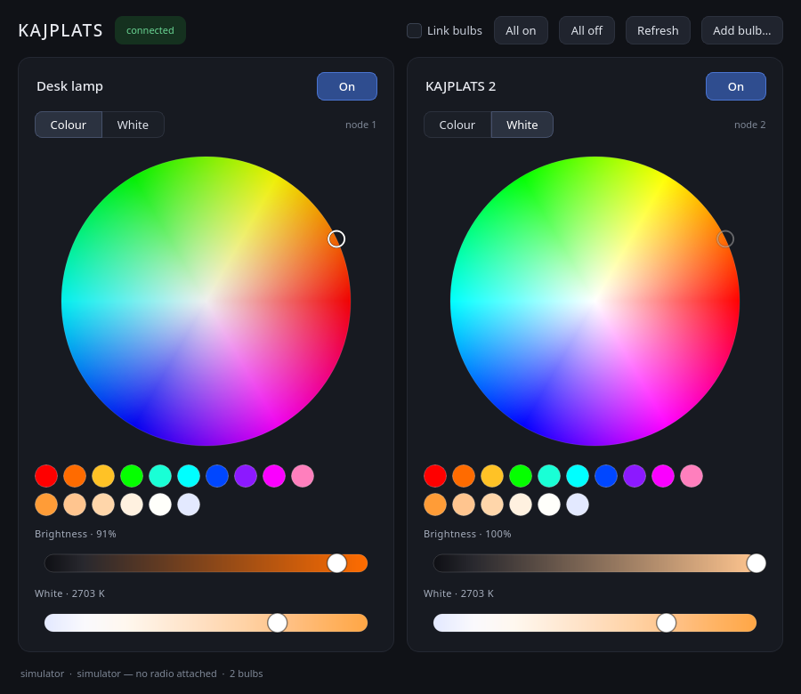

# kajplats-control

A desktop colour controller for IKEA **KAJPLATS** smart bulbs.



Two bulbs side by side, each with a hue/saturation wheel, a brightness ramp
tinted by the colour you picked, a colour-temperature slider from 2200 K to
6500 K, and preset swatches. "Link bulbs" applies every change to both at once.

## Run it now

```sh
uv run kajplats
```

That starts the **simulator** — two fake bulbs, no hardware needed. The whole
interface is live, so you can set it up the way you want before any radio
exists.

## Talking to the real bulbs

KAJPLATS is **Matter over Thread**. This matters more than it sounds:

> Thread is 802.15.4 radio, not Wi-Fi and not Bluetooth. Your PC cannot reach
> these bulbs over the network it already has. Bluetooth gets you through
> *commissioning* only; after that the bulb lives on a Thread mesh. You need an
> 802.15.4 radio and a Thread Border Router, full stop.

Once a border router exists, the chain is:

```
kajplats  ──websocket──>  matterjs-server  ──Matter──>  otbr-agent  ──802.15.4──>  bulb
```

### 1. The RCP radio — done

An ESP32-C6 is flashed with the OpenThread RCP firmware and verified:

```
NCP version      : openthread-esp32/362a1776ec2-43cc05a9b; esp32c6
Spinel protocol  : 4.3
RCP mode         : yes
```

The source lives in `firmware/ot_rcp` (copied out of esp-idf so builds do not
dirty the IDF tree). To rebuild or flash another board:

```sh
. ~/esp/esp-idf/export.sh
cd firmware/ot_rcp
idf.py -D SDKCONFIG_DEFAULTS="sdkconfig.defaults;sdkconfig.ci.rcp_usb" set-target esp32c6
idf.py build
idf.py -p /dev/ttyACM0 flash
uv run python tools/probe_rcp.py      # confirm it answers Spinel
```

> **The `rcp_usb` config matters.** The stock `ot_rcp` build talks over UART on
> GPIO 4/5, which needs a separate USB-serial adapter and jumper wires.
> `sdkconfig.ci.rcp_usb` sets `CONFIG_OPENTHREAD_RCP_USB_SERIAL_JTAG=y` so the
> C6's own USB port carries Spinel — one cable, enumerating as `/dev/ttyACM0`.

Once the RCP firmware is running it owns that USB port, so to reflash later
hold **BOOT** while plugging the board in.

### 2. Host preflight

```sh
bash tools/preflight.sh          # report only
bash tools/preflight.sh --fix    # also enable IPv6 forwarding and avahi
```

Thread needs two things most desktops have switched off: IPv6 forwarding (otbr
routes between the Thread mesh and your LAN) and a running mDNS responder
(Matter discovers everything over it). The script also prints which interface
carries your default route — that is the one to hand `otbr-agent -B`.

> **VPNs break this.** Thread and Matter rely on link-local IPv6 multicast and
> mDNS on the real LAN, which a VPN tunnel usually swallows. If commissioning
> stalls, disconnect it first.

### 3. Border router

```sh
yay -S ot-br-posix-git
sudo otbr-agent -I wpan0 -B <backbone-iface> 'spinel+hdlc+uart:///dev/ttyACM0'
```

Then form a Thread network and copy out its dataset:

```sh
sudo ot-ctl dataset init new
sudo ot-ctl dataset commit active
sudo ot-ctl ifconfig up
sudo ot-ctl thread start
sudo ot-ctl state              # 'leader' within ~10s
sudo ot-ctl dataset active -x  # the hex string the bulbs need
```

### 4. Matter server

```sh
npm install matter-server
npm install-scripts approve @stoprocent/noble @stoprocent/bluetooth-hci-socket \
    @stoprocent/bleno @serialport/bindings-cpp usb
npm install
npx matter-server --storage-path ~/.local/share/matter-server --bluetooth-adapter 0
```

> **npm 12 blocks native install scripts by default.** Skip the approve step
> and the package installs "successfully" but the Bluetooth HCI bindings are
> never built, so commissioning fails later with an unrelated-looking error.

Expect `Bluetooth enabled (hci-id=0)` and `BLE is enabled` in the log. No root
is needed for BLE.

### 5. Commission the bulbs

```sh
uv run kajplats --matter
```

Click **Add bulb…**, paste the Thread dataset hex from step 3, and enter the
pairing code printed on the bulb. Factory-reset a bulb first by power cycling
it six times. Repeat for the second bulb.

Afterwards `uv run kajplats --matter` is all you need.

```
--url ws://host:5580/ws   point at a matter-server on another machine
--bulbs N                 how many bulbs the simulator invents
-v                        debug logging
```

## Running it off a Raspberry Pi

`tools/pi-setup.sh` (on the Pi) and `tools/pi-migrate.sh` (on the laptop) move
the whole stack to an always-on Pi, freeing the laptop.

```sh
scp tools/pi-setup.sh pi@raspberrypi.local:
ssh pi@raspberrypi.local 'sudo bash pi-setup.sh'
tools/pi-migrate.sh pi@raspberrypi.local
```

Then, to use the GUI:

```sh
ssh -N -L 5580:localhost:5580 pi@raspberrypi.local &
uv run kajplats --matter
```

### Why co-located, and not a standalone ESP border router

The obvious idea - flash the C6 with `ot_br` so it runs as a wall-powered
border router on its own - was built and tested here, and it works as a Thread
router: the bulbs mesh to it, SRP registers them, it reaches them in 14 ms.

It still cannot drive the lights, because **Matter finds devices over mDNS**.
On a managed/apartment network that filters mDNS between clients, the border
router's service records never reach a controller on another machine. An
`avahi-browse` sweep of this network returned exactly one service - the
laptop's own - in 25 seconds.

The original laptop setup worked for a reason that is easy to miss:
`otbr-agent` ran on the *same host* as `matter-server`, so discovery happened
through local avahi over loopback and never touched the AP. Co-locating both
on the Pi preserves that property. Check your own network first:

```sh
avahi-browse -arpt | grep '^=' | wc -l     # ~1 means mDNS is filtered
```

### Notes

* **Memory.** matter-server peaks while reading each node's attributes. A Pi 3
  (1 GB) is comfortable; a Zero 2 W (512 MB) is tight, so `pi-setup.sh` enables
  zram.
* **The fabric moves, the bulbs stay paired.** `pi-migrate.sh` copies
  `~/.local/share/matter-server`, which holds the fabric credentials and每
  commissioned node. Starting a fresh fabric on the Pi would orphan both bulbs.
* **Only one controller at a time.** The migration disables the laptop's
  services; two hosts sharing a fabric identity will fight over the nodes.
* **The C6 goes back to RCP firmware** (`firmware/ot_rcp`) and plugs into the
  Pi. As an RCP it needs the USB *data* link, not just power.

## The undocumented Zigbee alternative

KAJPLATS bulbs also carry an unofficial Zigbee mode, and zigbee2mqtt has a
device page for `KAJPLATS_CWS`. With a Zigbee coordinator (~$20 Sonoff
CC2652P) that is a simpler stack than Thread — but IKEA neither documents nor
supports it, and it is not what this app speaks. Mentioned only so you know
the option exists.

## Layout

| File | What it does |
|---|---|
| `kajplats/model.py` | Bulb state, Matter unit conversions, the blackbody colour table |
| `kajplats/backend.py` | Backend interface and the offline simulator |
| `kajplats/matter.py` | WebSocket client for matterjs-server |
| `kajplats/controller.py` | Qt ↔ asyncio bridge, with per-channel rate limiting |
| `kajplats/widgets.py` | Colour wheel and gradient sliders |
| `kajplats/window.py` | Window, bulb cards, commissioning dialog |
| `kajplats/theme.py` | Dark stylesheet |

Dragging a wheel emits hundreds of values a second, which a Thread mesh will
not absorb. `controller.py` gives each bulb/channel pair a rail that keeps one
command in flight and drops superseded values, so the bulb lands on the value
you released on without a queue of stale ones behind it.

## Tests

```sh
uv run python tools/smoke.py out.png   # renders the UI headless and drives it
uv run python tools/test_matter.py     # backend against a stub matter-server
uv run python tools/probe_rcp.py       # asks the RCP radio for its version
uv run python tools/ot_console.py      # drives an ESP OpenThread CLI over USB
bash tools/preflight.sh                # host readiness for Thread + Matter
```

## Handheld remote

A battery-powered ESP32-C6 remote with an OLED and two knobs, talking to the
bulbs directly over Thread with no hub in the path — design, pin assignment
and power budget in [docs/remote.md](docs/remote.md).

## Licence

MIT — see [LICENSE](LICENSE).

`firmware/ot_br`, `firmware/ot_rcp` and `firmware/ot_common_components` are
copied from the ESP-IDF OpenThread examples (Espressif, Apache-2.0 / CC0) so
that builds do not dirty the IDF tree. `firmware/ot_br/main/esp_ot_br.c`
carries one local change: the stock auto-start sets up the border-router
plumbing but never enables the Thread interface, so a device with a dataset
already in NVS still boots with Thread down.
